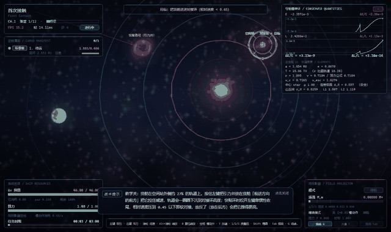
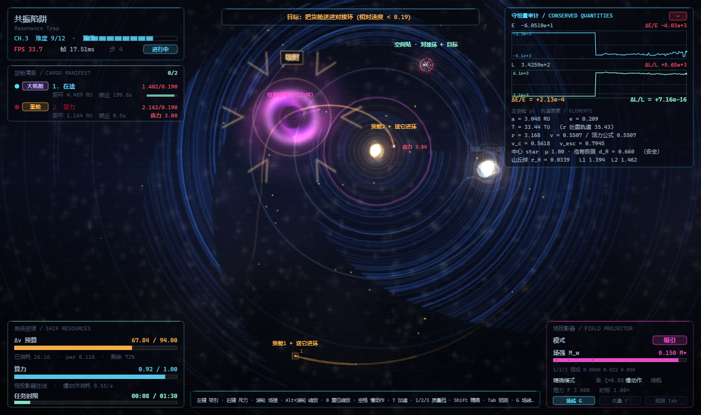
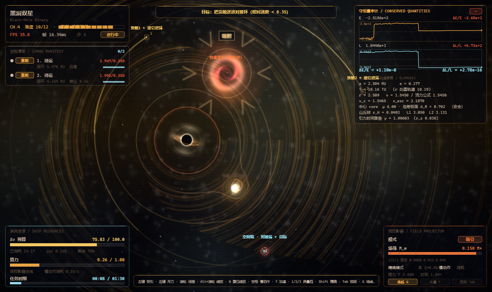
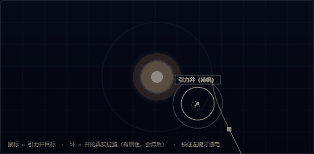

# 《牧星者 / STARHERD》

[](https://github.com/haimikao0721-a11y/Starherd/stargazers)
[](https://github.com/haimikao0721-a11y/Starherd/releases/latest)
[](LICENSE)
[](https://github.com/haimikao0721-a11y/Starherd/releases/latest)

> **你不是射手，你是引力源。**
>
> 鼠标拖动的不是飞船，而是一个**引力井**。用真实的牛顿引力把货舱从轨道上"拽"下来，
> 甩进空间站对接环 —— 引力弹弓、低推力螺旋转移、霍曼转移、洛希极限、拉格朗日点，
> 这些不是背景设定，是**每一步操作背后真正在算的东西**。



*引力井把货舱拽出原轨道 → 降低轨道高度 → 抵达对接环时压住相对速度完成软对接。上图为游戏内 AI 实机演示。*

<table>
<tr>
<td width="50%"><br><b>双星 + L4/L5 稳定岛</b><br>CR3BP 等边三角形顶点驻留</td>
<td width="50%"><br><b>黑洞 + 恒星双星</b><br>μ=6.0 黑洞、潮汐撕裂安全线、引力时间膨胀</td>
</tr>
</table>

> 更多实机动画：[`docs/demo/multibody.gif`](docs/demo/multibody.gif) ｜ [`docs/demo/blackhole.gif`](docs/demo/blackhole.gif) ｜ [`docs/demo/tutorial.gif`](docs/demo/tutorial.gif)

## 下载

三种形态任选其一（均**不需要安装 Python 或任何运行环境**）：

| 形态 | 文件 | 大小 | 说明 |
|---|---|---|---|
| **安装程序**（推荐） | `Starherd_Setup.exe` | 51.7 MB | 可选安装目录、创建桌面快捷方式与开始菜单项、带卸载入口 |
| 便携版 | `Starherd.exe` | 42.1 MB | 双击即运行，不写注册表 |
| 离线网页 | `Starherd_offline.html` | 8.1 MB | 零门槛：用浏览器打开即玩（无音乐下载入口） |

👉 **[前往 Releases 下载](https://github.com/haimikao0721-a11y/Starherd/releases/latest)**

> **首次运行提示（正常现象）**：程序未做数字签名，Windows 可能提示「已保护你的电脑 / 未知发布者」，
> 点 **「更多信息 → 仍要运行」** 即可。详见 [使用条款与免责声明](docs/使用条款与免责声明.md)。

## 操作

| 操作 | 作用 |
|---|---|
| **左键拖动** | 引力井吸引（最常用） |
| **右键拖动** | 斥力推开 |
| **滚轮** | 场强 ｜ **Alt+滚轮** 缩放视野 ｜ `0` 复位 |
| **空格** | 慢动作 ×0.25（消耗算力） ｜ **`T`** 时间加速 1×→2×→4× |
| `Tab` / `G` / `F` | 预测轨道 ｜ 引力场线 ｜ 速度矢量 |
| `1` `2` `3` | 场强质量档位 ｜ `Shift` 精确模式 |
| `R` / `Esc` / `H` | 重试本关 ｜ 暂停 ｜ 帮助 |

**玩不明白？** 主菜单有 **五幕操作演示**（引力井 / 左右键区别 / 怎么对接）：



**卡顿的话**：暂停 →「设置」里有 4 项性能开关 —— **渲染分辨率滑块**（手动 35%~100%，实测可省约 35% 帧时）、
**分辨率模式**（自动/手动）、**帧率上限**（不限/120/60/30）、**物理步长**（120 Hz 精确 / 60 Hz 弱机省 CPU）。
快捷键 `Y` 可直接循环帧率上限。

## 内容

**20 关 · 5 章 · 6 类多体系统**：单恒星 → 行星系·双卫星 → 双星 + L4/L5 稳定岛 → 黑洞 + 恒星 → 层级三合星。
4 种货舱变体（标准 / 重型 / 易碎 / 光帆），质量、半径、结构强度与受辐射压截面各不相同。

<details>
<summary><b>技术亮点（点开）</b></summary>

* **真实公式层**：Plummer 软化引力、速度 Verlet 辛积分 + 自适应子步、层级轨道（patched conic，
  卫星用行星 μ 求解）、洛希极限与潮汐撕裂半径、Hill 球、拉格朗日点、辐射压、星风脉冲、
  星云二次阻力、引力时间膨胀、霍曼转移、齐奥尔科夫斯基方程
* **公式库自带自检**：`python/physics_ref.py --selftest` → **123 项全部通过**
* **关卡校验器**：9 类判据（对接窗口、自动对接余量、生成间隙、轨道走廊、层级稳定性、
  Mardling & Aarseth 三体判据、章节内容规则…），并对 20 关给出**构造性可行性证明**
* **三合星的真实教训**：Mardling 判据只是层级稳定的**必要**条件 —— 边缘配置会被 Kozai-Lidov
  机制抽干、伴星被甩出系统。本作把层级比拉到 6:1 才让关卡真正可玩
* **自动驾驶能力下限探针**：内置 AI 会自己玩，用于验证"关卡确实能被通过"；
  20 关中 6 关有 AI 自动通关记录，全部 20 关有构造性可行性证明
* **性能**：自适应渲染分辨率（以目标帧率为预算动态伸缩），物理固定 120 Hz 步长，
  渲染随帧预算伸缩 —— 60 Hz 与 120 Hz 屏都能落在各自目标上
* **零第三方素材**：17 张美术 + 17 个音效 + 5 首音乐全部由本仓库的 Python 程序化生成/合成
  （固定随机种子，可复现）；背景音乐可在游戏内下载（EXE/网页模式的暂停页）
* **三种交付形态**：便携 EXE、可选目录安装程序、离线单文件网页（双击即玩）
</details>

## 构建（从源码复现）

需要 **Python 3.13** 与 **Node.js**：

```bash
npm install && node tools/build.mjs         # 前端打包 → dist/app.js
python python/build_exe.py                  # → dist_exe/Starherd.exe（便携版 + 冒烟验证）
python python/build_installer.py            # → dist_exe/Starherd_安装程序.exe（含静默自检）
python python/build_offline.py              # → dist_offline/Starherd_离线单文件版.html
```

开发时用宿主直接起网页版：

```bash
python python/mission_control.py --dev --port 8801     # 然后浏览器打开 127.0.0.1:8801
```

**验收工具**（改动物理/关卡后建议全跑一遍）：

```bash
python python/levelgen.py --validate        # 关卡校验器（须 PASS 0 问题）
python python/physics_ref.py --selftest     # 公式库自检（123/123）
python python/levelgen.py --analyze         # 20 关可行性分析（须 20/20 可行）
node tools/build.mjs && node tools/simtest.mjs assets/data/systems.json 150   # 自动通关回归
python tools/verify_ui.py                   # 无头浏览器端到端 UI 验收
python tools/verify_offline.py              # 离线单文件版验收
python tools/make_gifs.py                   # 重新录制本文档里的演示 GIF
```

## 项目结构

```
src/            TypeScript：sim（物理/世界/步进）、render（渲染与后处理）、game（状态机/自动驾驶）、ui（HUD/菜单）
python/         宿主（HTTP+WebSocket）、关卡生成与校验、公式库、素材/音乐生成、打包脚本
assets/         程序化生成的素材与 20 关关卡数据（systems.json）
tools/          构建、无头验收、GIF 录制
docs/           工程记录 / 设计文档 / 接口契约 / 使用条款 / 演示动画
web/            页面外壳与样式
```

## 许可

* 源码与本仓库内的程序化素材（含全部合成音乐）：**MIT**（见 [LICENSE](LICENSE)）
* 第三方组件：[THIRD_PARTY_NOTICES.md](THIRD_PARTY_NOTICES.md)（含 PyInstaller 的 Bootloader Exception 说明）
* 玩家条款与免责声明：[docs/使用条款与免责声明.md](docs/使用条款与免责声明.md)
* **版本历史**：[docs/CHANGELOG.md](docs/CHANGELOG.md)
* 技术实现与验证证据：[docs/工程记录.md](docs/工程记录.md) ｜ 设计：[docs/DESIGN.md](docs/DESIGN.md) ｜ 接口契约：[docs/INTERFACES.md](docs/INTERFACES.md)

---

**制作者**：海米糕（[@haimikao0721-a11y](https://github.com/haimikao0721-a11y)）
｜ **邮箱**：haimikao0721@gmail.com
｜ **仓库**：https://github.com/haimikao0721-a11y/Starherd
｜ 觉得好玩就点个 ⭐ **Star** —— 这是对独立开发者最实在的鼓励。

> 发现 bug、想加关卡、想聊公式，都欢迎写信：**haimikao0721@gmail.com**
